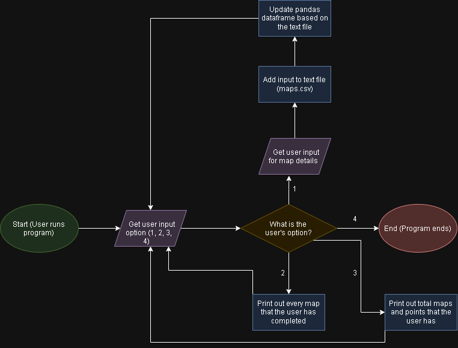

# KoG Tracker

This is a stats tracker for the King of Gores mod on DDNet.

## The Problem

I play a game called DDNet, specifically, a mod named "King of Gores". The website for this game that tracks all of the points you get for completing maps is extremely poorly maintained and almost never loads. I want to be able to track my points and map completions without having to rely on that website.

## How It Works

This program allows users to input maps they have completed. The maps are stored in a text file, and a pandas dataframe is created using that file. Users can then perform actions such as printing out the maps they have completed or printing out how many total maps and points they have.



## Tech Stack

- **Language:** Python
- **Libraries:** pandas, NumPy, datetime

## Setup

Note: You need to have python installed to run this program.
```bash
git clone https://github.com/jlee12345678/KoG-Tracker.git
cd KoG_Tracker/src
```

## Usage

```bash
py kog_tracker.py # Runs program
```

## Roadmap

- Weekly stats (maps completed in a certain week)
- Option to print out the hardest map difficulty that the user has completed
- Option to print out what date the user completed their first map of a certain difficulty (easy, main, hard, insane, extreme)


## Author

Jashwa Lee, [My GitHub Link](https://github.com/jlee12345678)